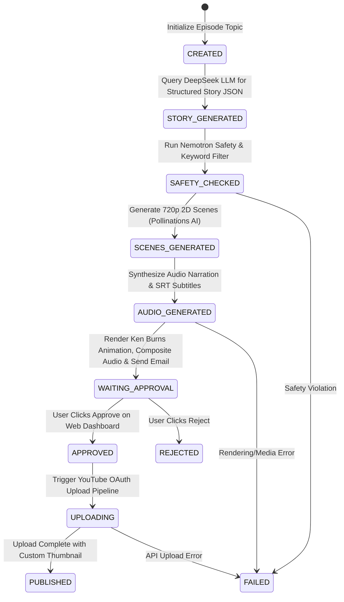

# 🎬 Kids Animated Video Studio

> **A modular local-first pipeline for generating, rendering, and publishing children's animated stories to YouTube. External AI services may have usage limits or costs.**

[](https://www.python.org/)
[](https://fastapi.tiangolo.com/)
[](https://build.nvidia.com/)
[](https://pollinations.ai/)
[](https://github.com/rany2/edge-tts)
[](https://opencv.org/)
[](https://developers.google.com/youtube/v3)

---

## 📌 Executive Summary

**Kids Animated Video Studio** is an experimental, modular automation project for turning story topics into narrated video episodes for review before YouTube publication.

Designed specifically for creator automation, the studio handles the entire creative lifecycle:
1. **AI Story Scripting & Prompting** (NVIDIA NIM / DeepSeek V4)
2. **Content Safety Checks** (Nemotron Content Safety + Keyword Filtering)
3. **2D Scene Art Generation** (Pollinations AI / Stable Diffusion & FLUX)
4. **Natural Neural Voice Narration & SRT Subtitles** (Microsoft Edge-TTS)
5. **Video Generation** (local LTX-Video 2B through ComfyUI, optional)
6. **Composite Video & Audio Rendering** (FFmpeg)
7. **Human-in-the-Loop Web Dashboard & Email Approval** (FastAPI & SMTP)
8. **YouTube Distribution** (OAuth-authorized YouTube Data API v3 upload)

Generated stories and media should be reviewed by an adult before publication. Automated
safety checks are not a guarantee that content is appropriate for every audience.

---

## 📐 System Architecture

The project follows a decoupled, event-driven modular architecture. The core pipeline is orchestrated via workflow drivers (`generate_pipeline` and `publish_pipeline`) backed by an **SQLite repository layer** for persistent state management and a **FastAPI Web Application** for human-in-the-loop review.

```mermaid
flowchart TD
    %% Clients & Entrances
    subgraph Interfaces ["💻 Client & Entry Points"]
        CLI["main.py (CLI)"]
        Dashboard["FastAPI Web Dashboard (http://localhost:8000)"]
    end

    %% State Persistence
    subgraph Storage ["💾 Storage & Persistence"]
        DB[(SQLite app.db)]
        FS["File System (/data/stories, /scenes, /audio, /renders)"]
    end

    %% Orchestration Workflows
    subgraph Orchestration ["⚙️ Core Workflow Engine"]
        GenPipe["Workflow: Generate Pipeline"]
        PubPipe["Workflow: Publish Pipeline"]
    end

    %% Intelligence Layer
    subgraph AI ["🧠 AI & Generative Layer"]
        NVIDIA_Client["NVIDIA NIM Client"]
        StoryGen["Story Generator (DeepSeek-V4)"]
        SafetyCheck["Safety Checker (Nemotron 3.5 & Keyword Rules)"]
        ImgGen["Scene Image Generator (Pollinations AI / PIL Fallback)"]
    end

    %% Audio & Media Engine
    subgraph Media ["🎨 Audio & Video Media Engine"]
        TTS["TTS Engine (Edge-TTS Neural Voice)"]
        Narrator["Episode Narrator & Timing Sync"]
        Animator["Scene Animator (Ken Burns 2D Zoom/Pan)"]
        Subtitles["Subtitle Renderer & SRT Generator"]
        ThumbGen["Thumbnail Generator"]
        Renderer["Video Renderer (OpenCV + FFmpeg Composite)"]
    end

    %% External Notifications & Uploads
    subgraph Integrations ["🌐 External Integrations"]
        Gmail["Gmail SMTP Notifier"]
        YouTube["YouTube Data API v3 Uploader"]
    end

    %% Connections
    CLI --> GenPipe
    CLI --> PubPipe
    Dashboard --> GenPipe
    Dashboard --> PubPipe

    GenPipe --> DB
    PubPipe --> DB

    GenPipe --> StoryGen
    StoryGen --> NVIDIA_Client
    GenPipe --> SafetyCheck
    SafetyCheck --> NVIDIA_Client

    GenPipe --> ImgGen
    GenPipe --> Narrator
    Narrator --> TTS

    GenPipe --> Animator
    GenPipe --> Subtitles
    GenPipe --> ThumbGen
    GenPipe --> Renderer

    Renderer --> FS
    GenPipe --> Gmail

    PubPipe --> YouTube
```



---

## 🧰 Technology Stack & Dependencies

| Domain | Technology / Library | Purpose & Rationale |
| :--- | :--- | :--- |
| **Language & Core** | **Python 3.10+** | Asynchronous execution, extensive media & AI ecosystem. |
| **Web Server & Framework** | **FastAPI** + **Uvicorn** + **Jinja2** | High-performance async REST API and real-time approval dashboard. |
| **Story & Script AI** | **NVIDIA NIM API** (`nvidia/nemotron-3-super-120b-a12b`) | NVIDIA-hosted reasoning model tested for structured children's story generation. |
| **Safety Audit AI** | **NVIDIA Nemotron** (`nvidia/nemotron-3.5-content-safety`) | Enterprise-grade safety classification guarding against inappropriate content. |
| **2D Art Generation** | **Pollinations.ai API** / **Pillow (PIL)** | Optional still images and fallback assets; Pollinations availability and quotas may change. |
| **Voice Synthesis** | **Edge-TTS** (`en-US-AnaNeural`) / **gTTS** | High-fidelity Microsoft Neural TTS offering expressive, kid-friendly voice modulation. |
| **Video Generation** | **ComfyUI + LTX-Video 2B distilled** (optional) | Local text-to-video scene clips. The default 512x288 and tested 640x352 settings remain experimental on 4 GB VRAM / 8 GB RAM, with limited motion and occasional text artifacts. |
| **Local Slideshow Mode** | **OpenCV (`opencv-python`)** | Ken Burns pan/zoom for `VIDEO_GENERATION_PROVIDER=local`; this is not AI video generation. |
| **Video Encoding** | **FFmpeg (`imageio-ffmpeg`)** | Audio multiplexing, frame rate conversion, and final MP4 compression. |
| **Database & Persistence** | **SQLite3** | Zero-configuration local database tracking episode status, asset paths, and YouTube metadata. |
| **Notifications** | **Python SMTP (`smtplib`)** | Immediate email dispatch with preview links when videos enter `WAITING_APPROVAL`. |
| **Publishing & Social** | **Google API Client** (`google-api-python-client`) | OAuth2-authenticated video upload marked as `selfDeclaredMadeForKids=True`. |

---

## 🔄 Detailed Workflow Pipeline

Every video goes through an 8-stage state machine tracked in SQLite (`VideoStatus` enum):



### Step-by-Step Execution Breakdown

1. **Phase 1: Story Scripting (`app/ai/story_generator.py`)**
   - Receives a prompt/topic (e.g., *"Milo the Bunny learns to share"*).
   - Prompts DeepSeek-V4 to produce structured JSON containing story title, moral lesson, scene narrations, visual prompts, visual style, and YouTube metadata (title, description, tags).

2. **Phase 2: Multi-Tier Content Safety (`app/ai/safety_checker.py`)**
   - Applies a **deterministic keyword filter** protecting against prohibited concepts (violence, scary themes, explicit content).
   - Validates the story with **NVIDIA Nemotron 3.5 Content Safety API** to ensure 100% child-wholesomeness.

3. **Phase 3: Scene Illustration (`app/ai/image_generator.py`)**
   - Requests 1280x720 2D cartoon illustrations from **Pollinations.ai**; service availability and terms may change.
   - If offline or API fails, uses a **Local Pillow Graphic Engine** to draw procedural cartoon scenes.

4. **Phase 4: Neural Voice Narration & SRT Subtitles (`app/audio/tts.py` & `app/video/subtitles.py`)**
   - Converts narration text per scene into `.mp3` audio using Microsoft `edge-tts` (Voice: `en-US-AnaNeural`).
   - Calculates exact audio duration and builds an `.srt` subtitle file.

5. **Phase 5: Video Rendering (`app/video/renderer.py`)**
   - `VIDEO_GENERATION_PROVIDER=comfyui` submits short text-to-video scenes to a local ComfyUI server using the LTX-Video 2B distilled model. The default is 512x288; 640x352 was also tested on an RTX 3050 with 4 GB VRAM and 8 GB RAM. This experimental configuration uses 12 FPS, Euler ancestral sampling, and at most 49 frames per scene; expect simpler visuals, limited motion, and occasional text artifacts.
   - `VIDEO_GENERATION_PROVIDER=local` instead animates still images with an OpenCV Ken Burns effect. That mode is a slideshow, not AI-generated motion.
   - `VIDEO_GENERATION_PROVIDER=pixazo` uses the optional hosted Pixazo API.
   - Overlays subtitles and combines scene clips with narration and ambient music using **FFmpeg**. If ComfyUI is selected but unavailable or fails, generation stops with an error rather than silently substituting a slideshow.

6. **Phase 6: Thumbnail Synthesis (`app/video/thumbnail.py`)**
   - Generates high-contrast YouTube thumbnails with title banners.

7. **Phase 7: Human-in-the-Loop Web Preview & Email (`app/email/gmail.py` & `app/web/server.py`)**
   - Sends an approval notification email via Gmail SMTP.
   - Displays the episode on the local **FastAPI Web Dashboard** (`http://localhost:8000`) for video playback, approval, or rejection.

8. **Phase 8: YouTube Upload (`app/youtube/uploader.py`)**
   - Upon one-click approval, uploads the final MP4 video to YouTube with custom title, description, tags, custom thumbnail, and sets `selfDeclaredMadeForKids=True`.

---

## 📂 Codebase & Folder Structure

```
animated_videos/
├── app/                        # Main Application Package
│   ├── ai/                     # AI Integration Layer
│   │   ├── nvidia_client.py    # OpenAI-compatible NVIDIA NIM client wrapper
│   │   ├── story_generator.py  # Script generation & JSON parsing
│   │   ├── safety_checker.py   # Multi-tier safety audit engine
│   │   └── image_generator.py  # Pollinations AI & Pillow illustration generator
│   ├── audio/                  # Audio Synthesis & Music Management
│   │   ├── tts.py              # Edge-TTS & gTTS integration engine
│   │   ├── narrator.py         # Episode scene timing & audio manager
│   │   └── music.py            # Ambient background music manager
│   ├── video/                  # Animation & Composite Video Renderer
│   │   ├── animator.py         # Ken Burns 2D camera zoom/pan motion engine
│   │   ├── subtitles.py        # Subtitle overlay renderer & SRT exporter
│   │   ├── renderer.py         # OpenCV frame writer & FFmpeg audio multiplexer
│   │   └── thumbnail.py        # Eye-catching thumbnail graphic builder
│   ├── database/               # Database Layer
│   │   ├── models.py           # Dataclasses & VideoStatus Enums
│   │   └── repository.py       # SQLite repository pattern implementation
│   ├── email/                  # Notification Service
│   │   └── gmail.py            # SMTP approval email notifier
│   ├── web/                    # FastAPI Web Dashboard
│   │   ├── server.py           # FastAPI routes & async background tasks
│   │   └── templates/          # Jinja2 HTML templates
│   │       └── index.html      # Responsive approval dashboard UI
│   ├── workflow/               # End-to-End Orchestration Pipelines
│   │   ├── generate.py         # Story-to-Video rendering workflow driver
│   │   └── publish.py          # Approval-to-YouTube publishing workflow driver
│   ├── youtube/                # YouTube Integration
│   │   ├── auth.py             # OAuth2 token authentication manager
│   │   └── uploader.py         # Resumable video upload service
│   ├── config/                 # System Settings & Prompts
│   │   ├── settings.py         # Environment variables & path resolver
│   │   └── prompts.py          # System & user LLM prompts
│   └── main.py                 # Unified Command Line Interface (CLI)
├── assets/                     # Fonts, background music & static assets
├── credentials/                # OAuth2 client secrets & YouTube token cache
├── data/                       # Local Storage (SQLite db, renders, logs, scenes)
├── .env.example                # Template for environment configuration
├── requirements.txt            # Python dependencies
└── README.md                   # Detailed Project Documentation
```

---

## ⚡ Installation & Setup Guide

### 1. Prerequisites
- **Python 3.10+** installed.
- **FFmpeg** installed and accessible in system `PATH` (or managed automatically via `imageio-ffmpeg`).

### 2. Clone and Install Dependencies
```bash
# Navigate to project root
cd animated_videos

# Create virtual environment
python -m venv venv

# Activate virtual environment
# Windows:
venv\Scripts\activate
# Linux/macOS:
source venv/bin/activate

# Install required Python packages
pip install -r requirements.txt
```

### 3. Environment Configuration (`.env`)
Create a `.env` file in the project root based on `.env.example`:

```ini
# NVIDIA NIM API Settings (Free credits at build.nvidia.com)
NVIDIA_API_KEY=nvapi-your-key-here
NVIDIA_BASE_URL=https://integrate.api.nvidia.com/v1
STORY_MODEL=nvidia/nemotron-3-super-120b-a12b
SAFETY_MODEL=nvidia/nemotron-3.5-content-safety
IMAGE_MODEL=stabilityai/stable-diffusion-xl-base-1.0

# Optional Fallback LLM Key
OPENAI_API_KEY=

# Audio / Voice Settings
TTS_ENGINE=edge-tts
DEFAULT_VOICE=en-US-AnaNeural
TTS_SPEED=+0%

# Local Web Dashboard Settings
PORT=8000
HOST=127.0.0.1
APP_URL=http://localhost:8000

# Gmail SMTP Email Notifications (Optional)
GMAIL_SENDER_EMAIL=your_email@gmail.com
GMAIL_RECIPIENT_EMAIL=your_email@gmail.com
GMAIL_APP_PASSWORD=your_google_app_password

# YouTube upload defaults
YOUTUBE_PRIVACY_STATUS=private  # options: private, unlisted, public
YOUTUBE_CATEGORY_ID=27          # 27 = Education, 1 = Film & Animation
```

Gmail notifications require a Google App Password (with 2-Step Verification enabled).
Create one in your Google Account security settings and store it only in your local
`.env` file; do not use your regular Gmail password or share the app password.
The project `.gitignore` excludes `.env`, generated `data/`, and `credentials/`.

---

## 🚀 Execution & Usage Guide

### Experimental local AI video (LTX-Video 2B)

This path needs a separate ComfyUI installation running on the same PC. It uses the
legacy LTX-Video 0.9.6 distilled 2B checkpoint, not current LTX-2.5. It is an
experiment: the 2B checkpoint and FP8 T5 text encoder may exceed available memory,
run slowly, or fail on the detected 4 GB GPU / 8 GB system RAM. Close other memory-heavy
applications before generation. The two model downloads total about 10.7 GiB,
before the ComfyUI installation and generated videos.

1. Install ComfyUI for Windows from the [official download page](https://www.comfy.org/download)
   and start its server on `http://127.0.0.1:8188`.
2. Download the [LTX-Video 2B distilled checkpoint](https://huggingface.co/Lightricks/LTX-Video/resolve/main/ltxv-2b-0.9.6-distilled-04-25.safetensors)
   into `ComfyUI/models/checkpoints/`.
3. Download the FP8 T5 text encoder
   [t5xxl_fp8_e4m3fn_scaled.safetensors](https://huggingface.co/comfyanonymous/flux_text_encoders/resolve/main/t5xxl_fp8_e4m3fn_scaled.safetensors)
   into `ComfyUI/models/text_encoders/` (older ComfyUI installs may use `models/clip/`).
4. Restart ComfyUI so it discovers the models. This app ships the API-format workflow
   in `app/config/ltxv_2b_api_workflow.json`; the model filenames must match the files
   above.
5. Set these values in `.env`:

   ```ini
   VIDEO_GENERATION_PROVIDER=comfyui
   COMFYUI_API_URL=http://127.0.0.1:8188
   COMFYUI_WIDTH=512
   COMFYUI_HEIGHT=288
   COMFYUI_FPS=12
   COMFYUI_MAX_FRAMES=49
   ```

   The workflow loads the text encoder on CPU and uses short, low-resolution clips to
   limit VRAM use. If ComfyUI reports out-of-memory errors, stop the portable launcher
   and run this from the portable install directory:

   ```powershell
   .\python_embeded\python.exe -s .\ComfyUI\main.py --windows-standalone-build --lowvram --reserve-vram 1 --listen 127.0.0.1
   ```

   No automatic still-image fallback occurs with this provider.

The system can be operated either via the **Command Line Interface (CLI)** or the **FastAPI Web Dashboard**.

### 1. Unified Command Line Interface (CLI)

#### Generate a New Animated Episode
```bash
python -m app.main generate --topic "Leo the Lion discovers the power of honesty"
```
*Outputs step-by-step pipeline logs, generates images, audio narration, subtitle files, thumbnail, composite video, and notifies via email.*

#### Start Web Dashboard & Approval Server
```bash
python -m app.main server --port 8000
```
*Access the dashboard at `http://localhost:8000`.*

#### Publish an Approved Episode to YouTube
```bash
python -m app.main publish --episode-id ep_1a2b3c4d
```
The episode must be in `WAITING_APPROVAL`. To explicitly retry a prior failed upload:
```bash
python -m app.main publish --episode-id ep_1a2b3c4d --retry-failed
```

#### List Database Video Records
```bash
python -m app.main list
```

In PowerShell, prefix a quoted Python executable path with the call operator:
```powershell
& 'C:\Path\To\python.exe' -m app.main list
```

---

### 2. FastAPI Web Dashboard & REST API

Launch the server with `python -m app.main server` and navigate to **`http://localhost:8000`**.

#### REST API Reference

| Method | Endpoint | Description |
| :--- | :--- | :--- |
| **`GET`** | `/` | Responsive HTML Web Approval Dashboard |
| **`GET`** | `/api/videos` | Returns JSON list of all video records in SQLite database |
| **`GET`** | `/api/media?path={file_path}` | Serves rendered MP4 videos, thumbnails, and audio clips |
| **`POST`** | `/api/generate` | Triggers background video generation task (`{"topic": "..."}`) |
| **`POST`** | `/api/approve/{episode_id}` | Publishes an episode only when it is waiting for approval |
| **`POST`** | `/api/reject/{episode_id}` | Rejects an episode only when it is waiting for approval |

The dashboard is intentionally local-only: it binds to `127.0.0.1` by default and
rejects requests from non-loopback clients. Mutating requests also require the
dashboard's same-origin CSRF token. The media endpoint only serves files under the
generated scenes, audio, renders, and thumbnails directories. Do not expose this
development dashboard to the public internet.

### YouTube OAuth Setup

A YouTube API key can access some public API data, but cannot upload videos. Uploads
use OAuth authorization for the Google account that manages the destination channel:

1. In Google Cloud Console, select the project, enable **YouTube Data API v3**, and
   configure the OAuth consent screen.
2. While the consent screen is in **Testing** mode, add the channel owner's Google
   account as a test user.
3. Create an OAuth client with application type **Desktop app** and download its JSON.
   Save it as `credentials/google_client_secret.json`.
4. Run the publish command. On first use, sign in to Google in the browser window and
   approve the requested YouTube upload scope. The refresh token is saved locally as
   `credentials/youtube_token.json`.
5. The default upload privacy is `private`. Review the uploaded video in YouTube Studio
   before changing its visibility.

Only continue through a Google Testing-mode warning if you recognize and control the
OAuth project. Never commit or share the client JSON or generated token. Both are
ignored by Git.

---

## 🔒 Safety, Privacy & Compliance

- **Made for Kids setting**: Uploads set YouTube's `"selfDeclaredMadeForKids": True`. This does not by itself establish legal compliance; the channel owner is responsible for reviewing the content and audience setting.
- **Safety checks**: Generated stories are checked before media synthesis, but automated checks can miss unsafe content. Review each episode before approval.
- **Secrets**: Never commit `.env`, `credentials/`, OAuth tokens, or API keys. If a credential has been shared or committed, revoke/rotate it.
- **YouTube uploads require OAuth**: A YouTube API key is not sufficient to upload. Enable the YouTube Data API v3 in the Google Cloud project, configure the OAuth consent screen, add your Google account as a test user while the app is in Testing mode, then create a **Desktop app** OAuth client. Save its downloaded JSON as `credentials/google_client_secret.json`. The CLI opens Google's authorization page on first upload and stores the resulting token at `credentials/youtube_token.json`; both files are excluded from Git. Authorize the Google account that manages the target channel. Only continue through a Testing-mode warning if you recognize and control the OAuth project.
- **Upload status**: Uploads without OAuth fail instead of being reported as successful. A `sim_yt_...` ID from an older run is not a real YouTube video ID.

---

## 📄 License

This repository is built for educational and automated content creation purposes. Distributed under the MIT License.
